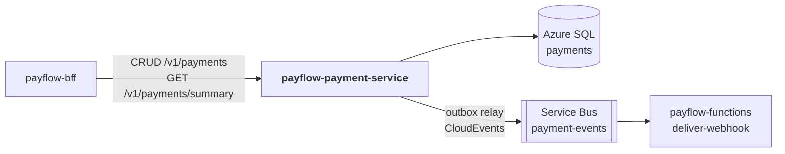

# payflow-payment-service

**Microsserviço 2 do PayFlow — domínio de Pagamentos**, persistido no **Azure SQL
Database** e produtor dos **eventos de pagamento** (Azure Service Bus). Em
desenvolvimento roda com SQL Server 2022 e o emulador oficial do Service Bus.

Parte da plataforma PayFlow (arc42 completo no repositório de documentação
[`PayFlow`](https://github.com/CaioSeniuk/PayFlow)). Alunos: **Caio Henrique,
Gabriel Moribe, Guilherme Celente e Leonardo Berlanda** — PUCPR, Arquitetura de
Soluções com Cloud, 2026.

## O que é este repositório

Serviço dono do **ciclo de vida do pagamento**: criação com cartão (token) ou PIX,
autorização em um **gateway de pagamento simulado**, consulta, alteração,
cancelamento, estorno, **idempotência** e publicação confiável de eventos com
**outbox transacional**. Também expõe o resumo usado pelo painel do lojista.

Requisitos da atividade atendidos: _"Microserviço 2 (Azure SQL) — Azure SQL
Database, outro domínio, CRUD completo, Swagger documentado"_ e o lado produtor da
**Event-Driven Architecture**.

## Relação com os outros repositórios



| Repositório | Relação |
|---|---|
| `payflow-bff` | Único consumidor HTTP: proxy do CRUD e dados de `/aggregated-data` (resumo + últimos pagamentos). Envia o `merchantId` já autenticado. |
| `payflow-functions` | Consome os eventos publicados na fila `payment-events` (`deliver-webhook`). |
| `payflow-merchant-service` | Nenhuma chamada direta; `merchant_id` é só referência lógica (Database per Service). |
| `payflow-frontend` | Nenhuma chamada direta. |

## Tecnologias

| Item | Escolha |
|---|---|
| Linguagem / framework | Java 21, Spring Boot 4.0 (Web MVC, Validation, Actuator, Data JPA) |
| Banco | Azure SQL Database (oferta gratuita); SQL Server 2022 local. Driver `mssql-jdbc` |
| Migrações | Flyway (`src/main/resources/db/migration`) |
| Mensageria | Azure Service Bus (Basic), SDK `azure-messaging-servicebus`; emulador oficial local |
| Resiliência | Resilience4j: timeout e circuit breaker no gateway simulado |
| Documentação | springdoc-openapi (`/swagger-ui.html`) + AsyncAPI 3 ([`docs/asyncapi.yaml`](docs/asyncapi.yaml)) |
| Testes | JUnit 5, ArchUnit, Testcontainers (SQL Server e emulador do Service Bus) |
| Contêiner | Dockerfile multi-stage (JDK → JRE, usuário não root) e `compose.yaml` com SQL Server + emulador |
| CI | GitHub Actions: testes em todo push; imagem no Docker Hub em tags `v*` |
| Execução na nuvem | Azure Container Apps (`ca-payflow-payment`) |

## Arquitetura interna (Clean Architecture + Vertical Slice)

| Camada | Pacote | Conteúdo |
|---|---|---|
| Domain | `domain/` | `Payment` (agregado e máquina de estados), `Refund`, `Money`, `PaymentDetails`, `CardToken`, `PaymentEvent`, porta `GatewayClient` — Java puro |
| Application | `features/<fatia>/` | `*Handler`, `*Command`/`*Query`, porta de saída própria da fatia |
| API | `features/<fatia>/*Endpoint`, `api/` | Controller REST da fatia; `api/` tem a representação comum (`PaymentResponse`) e os nomes dos cabeçalhos |
| Infrastructure | `infrastructure/` | `persistence/` (JPA + outbox + CloudEvents), `gateway/` (`SimulatedGatewayClient` + `ResilientGatewayClient`), `messaging/` (`OutboxRelay`, publicador Service Bus), `web/` (`PlatformCallerFilter`, `IdempotencyFilter`, Problem Details, Swagger) |

```text
src/main/java/br/com/payflow/payment/
├── domain/
├── api/                      PaymentResponse, ApiSecurity
├── features/
│   ├── createpayment/        POST   /v1/payments
│   ├── listpayments/         GET    /v1/payments
│   ├── getpayment/           GET    /v1/payments/{id}
│   ├── updatepayment/        PATCH  /v1/payments/{id}
│   ├── cancelpayment/        DELETE /v1/payments/{id}
│   ├── refundpayment/        POST   /v1/payments/{id}/refunds
│   ├── confirmpixpayment/    POST   /v1/payments/{id}/pix-confirmation
│   └── paymentsummary/       GET    /v1/payments/summary
└── infrastructure/
src/main/resources/db/migration/   V1__payments.sql
docs/asyncapi.yaml
```

Regras verificadas por `ArchitectureTests` (ArchUnit) a cada `./mvnw verify`, as
mesmas do merchant-service:

1. `domain` não importa framework (Spring, JPA, Hibernate, Azure, Resilience4j, Jackson…) nem outras camadas.
2. Uma fatia não importa outra.
3. Handlers, comandos e portas não importam framework (só `*Endpoint` e `*Slice` conhecem o Spring).
4. Fatias não importam `infrastructure`; o `JpaPaymentStore` implementa a porta de cada fatia.
5. `api/` só é usado por `*Endpoint` e pela infraestrutura web.
6. JPA, Hibernate, SDK do Azure e Resilience4j só aparecem em `infrastructure`.

## Endpoints

Todas as rotas `/v1/**` exigem `X-Internal-Key` (chamadas vindas do BFF, senão 401) e
`X-Merchant-Id` (UUID do lojista autenticado pelo BFF, senão 400). Pagamento de outro
lojista responde 404.

| Método | Rota | Descrição |
|---|---|---|
| POST | `/v1/payments` | Cria pagamento `CARD` (token `tok_approved`, `tok_declined`, `tok_timeout`) ou `PIX`. Exige `Idempotency-Key`. 201 + `Location` |
| GET | `/v1/payments` | Lista, mais recentes primeiro. Filtros `status`, `method`, `from`, `to` (ISO-8601), `page`, `size` (até 100) |
| GET | `/v1/payments/{id}` | Detalha, com os estornos |
| PATCH | `/v1/payments/{id}` | Altera `description` e `metadata` (campo ausente fica como está) |
| DELETE | `/v1/payments/{id}` | Cancela pagamento `PENDING` (status `CANCELED`; não apaga o registro) |
| POST | `/v1/payments/{id}/refunds` | Estorno total (sem `amount`) ou parcial. Exige `Idempotency-Key` |
| POST | `/v1/payments/{id}/pix-confirmation` | Simula a confirmação do PIX pelo gateway |
| GET | `/v1/payments/summary` | Totais para o painel (filtro opcional `from`, `to`) |
| GET | `/actuator/health` | Health check |
| GET | `/swagger-ui.html` | Swagger |

Criação (valores em centavos, `currency` opcional e só `BRL`):

```json
{ "amount": 1990, "method": "CARD", "cardToken": "tok_approved",
  "description": "Pedido 42", "metadata": { "order_id": "42" } }
```

Resposta (o token do cartão nunca volta):

```json
{
  "id": "…", "merchantId": "…", "amount": 1990, "currency": "BRL",
  "method": "CARD", "status": "AUTHORIZED", "refundedAmount": 0,
  "card": { "last4": "4242" }, "pix": null, "gatewayReference": "gw_ch_…",
  "description": "Pedido 42", "metadata": { "order_id": "42" }, "refunds": [],
  "createdAt": "…", "updatedAt": "…"
}
```

PIX volta `PENDING` com `pix.qrCode` no formato BR Code ("copia e cola", com CRC
válido e conta fictícia).

Resumo do painel (`GET /v1/payments/summary`). `count` e `byStatus` contam todos os
pagamentos; `totalAmount` e `byMethod` somam o volume aprovado líquido de estornos
(`AUTHORIZED`, `CONFIRMED`, `PARTIALLY_REFUNDED`, `REFUNDED` menos o estornado), que é a
base da Function `calculate-fees`:

```json
{ "currency": "BRL", "totalAmount": 10500, "count": 2,
  "byStatus": { "PENDING": 0, "AUTHORIZED": 0, "DECLINED": 0, "CONFIRMED": 1,
                "CANCELED": 0, "PARTIALLY_REFUNDED": 1, "REFUNDED": 0 },
  "byMethod": { "CARD": 7500, "PIX": 3000 } }
```

Erros em Problem Details (RFC 9457): 400 dados inválidos (motivo em `detail`), 401 sem
`X-Internal-Key`, 404 inexistente ou de outro lojista, 409 transição inválida ou
alteração concorrente, 422 `Idempotency-Key` reutilizada com outro corpo, 503 circuito
aberto (com `Retry-After`), 504 gateway sem resposta.

Máquina de estados: `PENDING → CONFIRMED | CANCELED` (PIX), `AUTHORIZED | DECLINED`
(cartão), `AUTHORIZED/CONFIRMED → PARTIALLY_REFUNDED → REFUNDED`; o estorno total vai
direto para `REFUNDED`.

### Idempotência

`Idempotency-Key` é obrigatório na criação e no estorno (até 255 caracteres, único por
lojista, válido por 24 h), conforme o rascunho IETF _The Idempotency-Key HTTP Header Field_:

| Situação | Resposta |
|---|---|
| Primeira vez | Processa e guarda a resposta |
| Mesma chave e mesmo corpo | A resposta guardada, com `Idempotent-Replayed: true` |
| Mesma chave, corpo diferente | 422 |
| Mesma chave enquanto a primeira ainda processa | 409 |
| Primeira terminou em 5xx (ex.: `tok_timeout`) | Nada é guardado; a mesma chave pode tentar de novo |

### Gateway simulado

`tok_approved` (ou qualquer outro `tok_*`) aprova, `tok_declined` recusa e
`tok_timeout` demora mais que o timeout (2 s): a API responde 504 e **nada é gravado**,
então a mesma requisição pode ser repetida. Um token terminado em `_NNNN`
(`tok_visa_1234`) devolve esses dígitos em `card.last4`. Depois de 5 chamadas com 50% de
falhas, o circuit breaker abre por 30 s e as chamadas respondem 503 sem tocar o gateway.

## Modelo de dados (Azure SQL)

| Tabela | Conteúdo |
|---|---|
| `payment` | id, merchant_id, amount_cents, currency, method, status, card_token, card_last4, pix_qr_code, gateway_reference, description, metadata (JSON), created_at, updated_at, version |
| `refund` | id, payment_id (FK), amount_cents, reason, created_at |
| `idempotency_key` | (merchant_id, idem_key) PK, request_hash, response_status, response_body, created_at, expires_at |
| `outbox_event` | id, aggregate_id, type, payload (CloudEvent JSON), occurred_at, published_at |

Pagamento, estorno e evento de outbox são gravados **na mesma transação**; `version`
faz o controle otimista de concorrência (dois estornos simultâneos: um recebe 409).

## Eventos publicados (fila `payment-events`)

`payment.authorized`, `payment.declined`, `payment.pending`, `payment.confirmed`,
`payment.refunded`, `payment.canceled` — envelope **CloudEvents 1.0** em modo
estruturado, com a extensão `merchantid`. Contrato completo em
[`docs/asyncapi.yaml`](docs/asyncapi.yaml).

O `OutboxRelay` lê a cada 2 s até 50 eventos de `outbox_event` sem `published_at`
(`UPDLOCK, READPAST`, seguro com várias réplicas), publica e marca como publicados. Se
o Service Bus falhar, os eventos ficam pendentes e saem na próxima rodada. A entrega é
pelo menos uma vez: o `messageId` é o `id` do evento, para o consumidor descartar
repetições. Sem `SERVICEBUS_CONNECTION_STRING`, o serviço funciona e os eventos ficam
guardados até a conexão ser configurada.

## Estado atual

- [x] Domínio `Payment`/`Refund`/`Money` com testes unitários
- [x] Migração Flyway V1
- [x] Fatias CRUD + estorno + PIX + summary
- [x] `IdempotencyFilter` e `SimulatedGatewayClient` com Resilience4j
- [x] Outbox + `OutboxRelay` + publicador Service Bus
- [x] `docs/asyncapi.yaml`
- [x] springdoc-openapi
- [x] 68 testes: unitários, 6 regras ArchUnit, 13 de integração com SQL Server real e 1 com o emulador do Service Bus
- [x] Dockerfile, `compose.yaml` (SQL Server + emulador do Service Bus) e GitHub Actions
- [ ] Publicar `v1` no Docker Hub e implantar no Container Apps

## Como rodar localmente

Pré-requisitos: Docker com Compose v2 (ou JDK 21 ou mais recente para rodar sem Docker
e para os testes). No Mac com Apple Silicon, o SQL Server roda pela emulação Rosetta do
Docker Desktop (não há imagem arm64); deixe pelo menos 4 GB de memória para o Docker.

### Com Docker (SQL Server + emulador do Service Bus + serviço)

```bash
cp .env.example .env
docker compose up -d --build
curl http://localhost:8082/actuator/health
```

Swagger em http://localhost:8082/swagger-ui.html (*Authorize* com o
`PAYFLOW_INTERNAL_KEY` do `.env`; `X-Merchant-Id` pode ser o lojista demo
`00000000-0000-0000-0000-000000000001`). Na primeira subida o emulador leva 1 a 2
minutos para ficar pronto; até lá os eventos esperam no outbox. Saúde do emulador:
`curl http://localhost:5300/health`. Para parar: `docker compose down` (`-v` apaga os dados).

### Sem Docker para o serviço

```bash
cp .env.example .env
docker compose up -d sqlserver sqlserver-init servicebus
./mvnw spring-boot:run -Dspring-boot.run.profiles=local   # http://localhost:8080
```

O perfil `local` lê o `.env` desta pasta e, sem `AZURE_SQL_*` e
`SERVICEBUS_CONNECTION_STRING`, usa o SQL Server em `localhost:1433` e o emulador em
`localhost:5672`.

### Exemplos

```bash
B=http://localhost:8082
H=(-H "X-Internal-Key: local-dev-internal-key-0123456789abcdef"
   -H "X-Merchant-Id: 00000000-0000-0000-0000-000000000001" -H 'Content-Type: application/json')

curl -X POST "${H[@]}" -H "Idempotency-Key: pedido-1" $B/v1/payments \
  -d '{"amount":10000,"method":"CARD","cardToken":"tok_approved"}'
curl -X POST "${H[@]}" -H "Idempotency-Key: estorno-1" $B/v1/payments/<id>/refunds -d '{"amount":2500}'
curl -X POST "${H[@]}" -H "Idempotency-Key: pix-1" $B/v1/payments -d '{"amount":3000,"method":"PIX"}'
curl -X POST "${H[@]}" $B/v1/payments/<id>/pix-confirmation
curl "${H[@]}" $B/v1/payments/summary
```

### Testes

```bash
./mvnw verify   # requer Docker em execução (Testcontainers)
```

Os testes de integração sobem um SQL Server 2022 e o emulador do Service Bus isolados;
nunca acessam o Azure.

### Variáveis de ambiente

| Variável | Descrição |
|---|---|
| `AZURE_SQL_URL` | `jdbc:sqlserver://<server>.database.windows.net:1433;database=payments;encrypt=true` (local: `sqlserver:1433`, banco `payments`) |
| `AZURE_SQL_USERNAME` / `AZURE_SQL_PASSWORD` | Credenciais (segredo). Local: `sa` / `MSSQL_SA_PASSWORD` |
| `SERVICEBUS_CONNECTION_STRING` | Connection string com permissão `Send` (segredo). Local: a do emulador. Vazia: eventos ficam no outbox |
| `SERVICEBUS_QUEUE` | `payment-events` |
| `PAYFLOW_INTERNAL_KEY` | Chave compartilhada com o BFF, 32 a 256 caracteres (segredo, obrigatória) |
| `PORT` | Porta HTTP do processo; padrão `8080` |
| `MSSQL_SA_PASSWORD`, `API_PORT`, `SQL_PORT` | Só do `compose.yaml` local (porta publicada padrão `8082`) |

Os valores do `.env.example` são só para desenvolvimento local. Na nuvem, gere chaves
novas com `openssl rand -hex 32`.

## Infraestrutura na nuvem

- **Azure SQL**: servidor `sql-payflow`, banco `payments` (oferta gratuita, serverless com auto-pause). Firewall "Allow Azure services". O Flyway cria as tabelas no primeiro startup.
- **Service Bus**: namespace `sb-payflow` (Basic), fila `payment-events`, `MaxDeliveryCount = 5`, lock 60 s.
- **Container Apps**: `ca-payflow-payment`, ingress externo 8080 (para o Swagger), secrets `sql-password`, `servicebus-connection`, `internal-key`, `MANAGEMENT_ENDPOINT_HEALTH_PROBES_ENABLED=true`.

## Publicação

Pelo GitHub Actions: cadastre os segredos `DOCKERHUB_USERNAME` e `DOCKERHUB_TOKEN` no
repositório e crie uma tag:

```bash
git tag v1 && git push origin v1   # publica docker.io/<usuario>/payflow-payment-service:v1
```

Ou manualmente:

```bash
docker buildx build --platform linux/amd64 \
  -t docker.io/<dockerhub-user>/payflow-payment-service:v1 --push .
```

## Links

| Item | URL |
|---|---|
| Swagger (nuvem) | _a publicar_ |
| AsyncAPI | [`docs/asyncapi.yaml`](docs/asyncapi.yaml) |
| Docker Hub | _a publicar_ |
| Documentação de arquitetura | https://github.com/CaioSeniuk/PayFlow |
