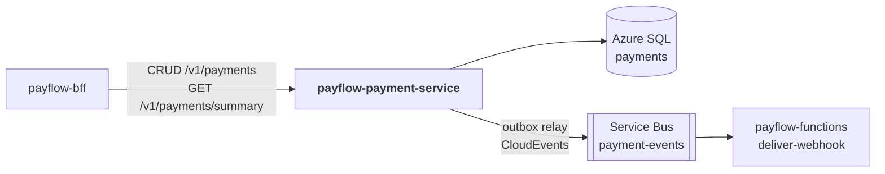

# payflow-payment-service

**Microsserviço 2 do PayFlow — domínio de Pagamentos**, persistido no **Azure SQL
Database** e produtor dos **eventos de pagamento** (Azure Service Bus).

Parte da plataforma PayFlow (arc42 completo no repositório de documentação
[`PayFlow`](https://github.com/CaioSeniuk/PayFlow)). Alunos: **Caio Henrique,
Gabriel Moribe, Guilherme Celente e Leonardo Berlanda** — PUCPR, Arquitetura de
Soluções com Cloud, 2026.

## O que é este repositório

Serviço dono do **ciclo de vida do pagamento**: criação com cartão (token) ou PIX,
autorização em um **gateway de pagamento simulado**, consulta, alteração,
cancelamento, estorno, **idempotência** e publicação confiável de eventos com
**outbox transacional**. Também expõe o resumo usado pelo painel do lojista.

Requisitos da atividade atendidos: _"Microserviço 2 (Azure SQL) — Azure SQL
Database, outro domínio, CRUD completo, Swagger documentado"_ e o lado produtor da
**Event-Driven Architecture**.

## Relação com os outros repositórios



| Repositório | Relação |
|---|---|
| `payflow-bff` | Único consumidor HTTP: proxy do CRUD e dados de `/aggregated-data` (resumo + últimos pagamentos). Envia o `merchantId` já autenticado. |
| `payflow-functions` | Consome os eventos publicados na fila `payment-events` (`deliver-webhook`). |
| `payflow-merchant-service` | Nenhuma chamada direta; `merchant_id` é só referência lógica (Database per Service). |
| `payflow-frontend` | Nenhuma chamada direta. |

## Tecnologias

| Item | Escolha |
|---|---|
| Linguagem / framework | Java 21, Spring Boot 4 (Web MVC, Validation, Actuator, Data JPA) |
| Banco | Azure SQL Database (oferta gratuita), driver `mssql-jdbc` |
| Migrações | Flyway |
| Mensageria | Azure Service Bus (Basic), SDK `azure-messaging-servicebus` |
| Resiliência | Resilience4j (timeout e circuit breaker no gateway simulado) |
| Documentação | springdoc-openapi (`/swagger-ui.html`) + AsyncAPI 3 (`docs/asyncapi.yaml`) |
| Testes | JUnit 5, ArchUnit, Testcontainers (MS SQL Server), MockMvc |
| Contêiner | Dockerfile multi-stage (JDK → JRE, usuário não root) |
| Registro | Docker Hub: `docker.io/<dockerhub-user>/payflow-payment-service:<tag>` |
| Execução na nuvem | Azure Container Apps (`ca-payflow-payment`) |

## Arquitetura interna (Clean Architecture + Vertical Slice)

| Camada | Pacote | Conteúdo |
|---|---|---|
| Domain | `domain/` | `Payment` (agregado e máquina de estados), `Refund`, `Money`, `PaymentStatus`, `PaymentMethod`, eventos de domínio — Java puro |
| Application | `features/<fatia>/` | `*Handler`, `*Command`/`*Result`, portas (`PaymentRepository`, `GatewayClient`, `OutboxWriter`, `IdempotencyStore`) |
| API | `features/<fatia>/*Endpoint` | Controller REST da fatia |
| Infrastructure | `infrastructure/` | `persistence/` (JPA), `gateway/` (`SimulatedGatewayClient`), `messaging/` (`OutboxRelay`, publicador Service Bus), `web/` (`IdempotencyFilter`, `X-Internal-Key`, Problem Details), `config/` |

Estrutura-alvo:

```text
src/main/java/br/com/payflow/payment/
├── domain/
├── features/
│   ├── createpayment/        POST   /v1/payments
│   ├── listpayments/         GET    /v1/payments
│   ├── getpayment/           GET    /v1/payments/{id}
│   ├── updatepayment/        PATCH  /v1/payments/{id}
│   ├── cancelpayment/        DELETE /v1/payments/{id}
│   ├── refundpayment/        POST   /v1/payments/{id}/refunds
│   ├── confirmpixpayment/    POST   /v1/payments/{id}/pix-confirmation
│   └── paymentsummary/       GET    /v1/payments/summary
└── infrastructure/
src/main/resources/db/migration/   V1__payments.sql …
docs/asyncapi.yaml
```

## Endpoints previstos

Todas as rotas `/v1/**` exigem `X-Internal-Key` (chamadas vindas do BFF) e
`X-Merchant-Id` (lojista autenticado pelo BFF).

| Método | Rota | Descrição |
|---|---|---|
| POST | `/v1/payments` | Cria pagamento `CARD` (token `tok_approved`, `tok_declined`, `tok_timeout`) ou `PIX`. Exige `Idempotency-Key`. |
| GET | `/v1/payments` | Lista com filtros `status`, `method`, `from`, `to`, paginação |
| GET | `/v1/payments/{id}` | Detalha (com estornos) |
| PATCH | `/v1/payments/{id}` | Altera descrição/metadados |
| DELETE | `/v1/payments/{id}` | Cancela pagamento `PENDING` (status `CANCELED`; não apaga o registro) |
| POST | `/v1/payments/{id}/refunds` | Estorno total ou parcial. Exige `Idempotency-Key`. |
| POST | `/v1/payments/{id}/pix-confirmation` | Simula a confirmação do PIX pelo gateway |
| GET | `/v1/payments/summary` | Totais por status e método (para o painel) |
| GET | `/actuator/health` | Health check |
| GET | `/swagger-ui.html` | Swagger |

Máquina de estados: `PENDING → CONFIRMED | CANCELED`, `AUTHORIZED | DECLINED`
(cartão), `AUTHORIZED/CONFIRMED → PARTIALLY_REFUNDED → REFUNDED`.

## Modelo de dados (Azure SQL)

| Tabela | Conteúdo |
|---|---|
| `payment` | id, merchant_id, amount_cents, currency, method, status, card_token, card_last4, pix_qr_code, gateway_reference, description, created_at, updated_at, version |
| `refund` | id, payment_id (FK), amount_cents, reason, created_at |
| `idempotency_key` | (merchant_id, idem_key) PK, request_hash, response_status, response_body, expires_at |
| `outbox_event` | id, aggregate_id, type, payload, occurred_at, published_at |

Pagamento, estorno e evento de outbox são gravados **na mesma transação**.

## Eventos publicados (fila `payment-events`)

`payment.authorized`, `payment.declined`, `payment.pending`, `payment.confirmed`,
`payment.refunded`, `payment.canceled` — envelope **CloudEvents 1.0**, documentados
em `docs/asyncapi.yaml` (link "Eventos" da entrega). O `OutboxRelay` lê
`outbox_event` sem `published_at` a cada 2 s, publica e marca como publicado.

## Estado atual

Repositório novo; nada implementado.

- [ ] Projeto Spring Boot (Maven Wrapper, Java 21), Dockerfile e `compose.yaml` (Azure SQL Edge + Service Bus emulator)
- [ ] Domínio `Payment`/`Refund`/`Money` com testes unitários
- [ ] Migração Flyway V1
- [ ] Fatias CRUD + estorno + PIX + summary
- [ ] `IdempotencyFilter` e `SimulatedGatewayClient` com Resilience4j
- [ ] Outbox + `OutboxRelay` + publicador Service Bus
- [ ] `docs/asyncapi.yaml`
- [ ] springdoc-openapi
- [ ] ArchUnit (mesmas regras do merchant-service) e Testcontainers MS SQL
- [ ] Publicar `v1` no Docker Hub e implantar no Container Apps
- [ ] GitHub Actions

## Como rodar localmente (previsto)

```bash
cp .env.example .env
docker compose up -d                 # SQL Server local + Service Bus emulator
./mvnw spring-boot:run -Dspring-boot.run.profiles=local
./mvnw verify                        # testes unitários, arquitetura e integração
```

### Variáveis de ambiente

| Variável | Descrição |
|---|---|
| `AZURE_SQL_URL` | `jdbc:sqlserver://<server>.database.windows.net:1433;database=payments;encrypt=true` |
| `AZURE_SQL_USERNAME` / `AZURE_SQL_PASSWORD` | Credenciais (segredo) |
| `SERVICEBUS_CONNECTION_STRING` | Connection string com permissão `Send` (segredo) |
| `SERVICEBUS_QUEUE` | `payment-events` |
| `PAYFLOW_INTERNAL_KEY` | Chave compartilhada com o BFF |
| `PORT` | Porta HTTP; padrão `8080` |

## Infraestrutura na nuvem

- **Azure SQL**: servidor `sql-payflow`, banco `payments` (oferta gratuita, serverless com auto-pause). Firewall "Allow Azure services".
- **Service Bus**: namespace `sb-payflow` (Basic), fila `payment-events`, `MaxDeliveryCount = 5`, lock 60 s.
- **Container Apps**: `ca-payflow-payment`, ingress externo 8080 (para o Swagger), secrets `sql-password`, `servicebus-connection`, `internal-key`.

## Publicação

```bash
docker buildx build --platform linux/amd64 \
  -t docker.io/<dockerhub-user>/payflow-payment-service:v1 --push .
```

## Links

| Item | URL |
|---|---|
| Swagger (nuvem) | _a publicar_ |
| AsyncAPI | _a publicar_ |
| Docker Hub | _a publicar_ |
| Documentação de arquitetura | https://github.com/CaioSeniuk/PayFlow |
